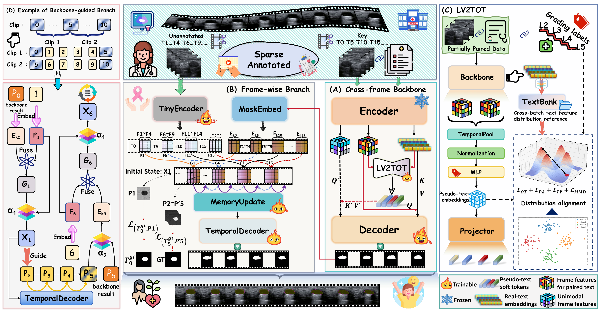

<div align="center">

# TF-BVS

### Text-Free Breast Ultrasound Video Segmentation

<p>
  <a href="assets/TF-BVS_ACM_MM_2026_Paper.pdf"></a>
</p>

<p>
  <a href="https://2026.acmmm.org/"></a>
  
  
</p>

<p>
  <b>No caption at inference time? No problem.</b><br>
  TF-BVS turns visual-temporal evidence into a robust segmentation prompt.
</p>

<p>
  <a href="#quick-start">Quick Start</a> ·
  <a href="#citation">Citation</a>
</p>

</div>

> 🎉 Our paper **“A Large-Scale Multi-Modal Benchmark and Robust Text-Free Inference for Breast Ultrasound Video Segmentation”** has been accepted by **ACM Multimedia 2026**.

## Model overview

<p align="center">
  
</p>

<p align="center"><em>TF-BVS: cross-frame backbone, frame-wise temporal branch, and LV2TOT prompt learning.</em></p>

<p align="center">
  <a href="assets/tf-bvs-model-architecture.pdf">Download the original PDF figure</a>
</p>

## Open-source status

<p align="center">
  <b>🚀 Release radar</b><br>
  <code>code ━━━━━━━●━━━━━━ data</code>
</p>

| Component | Status |
|:--|:--|
| 🧠 Training and inference code | ✅ Open source |
| 🧪 Validation-based checkpoint selection | ✅ Included |
| 📏 Unified evaluation scripts | ✅ Included |
| 🗺️ Model architecture figure | ✅ Available above |
| 🩺 MBTUVS dataset | ⏳ Release pending |

> ✨ The code is out. The data is waiting at the gate. Stay tuned for the next drop.

## Quick start

### 1. Install

```bash
conda create -n tfbvs python=3.10
conda activate tfbvs
pip install -r requirements.txt
```

Build the Deformable Attention extension:

```bash
cd models/GroundingDINO/ops
python setup.py build install
cd ../../
```

Prepare these resources locally. They are intentionally not included in the repository:

- processed MBTUVS data with `train`, `valid`, and `test` splits;
- a local `bert-base-uncased` snapshot;
- the Swin-B COCO checkpoint;
- the GroundingDINO Swin-B checkpoint.

```bash
cd /path/to/TF-BVS
export PYTHONPATH=.
export DATA_ROOT=/path/to/processed_breast_ultrasound_5frames
export TEXT_ENCODER_PATH=/path/to/bert-base-uncased
export COCO_WEIGHTS=/path/to/coco_swinb.pth
export DINO_WEIGHTS=/path/to/groundingdino_swinb_cogcoor.pth
export TRANSFORMERS_NO_TF=1
export USE_TF=0
```

Set `GroundingDINO.pretrained_path` and `dataset_path` in `configs/ytvos_swinb.yaml` to the corresponding local resources.

### 2. Fresh training from epoch 0 with validation-based selection

The validation wrapper trains one epoch at a time, evaluates the `valid` split after each epoch, and keeps the checkpoint with the best combined score. The test split is never used for model selection.

**Initialization note.** This is a fresh TF-BVS training run, not a resumed run, but it is **not strict random initialization**. The reference recipe uses three pretrained resources:

- `GroundingDINO.pretrained_path` loads the GroundingDINO Swin-B checkpoint during model construction;
- `--pretrained_weights "$COCO_WEIGHTS"` loads the COCO Swin-B initialization on the first epoch;
- `TEXT_ENCODER_PATH` provides the pretrained `bert-base-uncased` text encoder.

The command intentionally does not pass `-ckpt` or `--resume-from`. The validation wrapper uses the pretrained initialization only for epoch 0, then loads the newly produced epoch checkpoint for subsequent epochs. Removing these initialization resources would be a different random-initialization experiment and would not reproduce the reported setup.

```bash
python scripts/rebuttal/train_with_validation.py \
  --total-epochs 60 \
  --validation-dataset-path "$DATA_ROOT" \
  --validation-dataset-root "$DATA_ROOT" \
  --validation-split valid \
  --validation-num-gpus 4 \
  --frame-step 5 \
  --score-weights 0.5 0.3 0.2 \
  -- python main.py \
    -c configs/ytvos_swinb.yaml -rm train -ng 4 -bs 2 \
    --epochs 60 --version tfbvs_online_valid \
    --lr_drop 30 --lr_scale 0.25 --enable_amp false \
    --pretrained_weights "$COCO_WEIGHTS" \
    --use_ot_prompt true --textfree_infer true --textless_prob 0.5 \
    --w_ot 5.0 --w_contrast 0.0 --w_pair 4.0 --w_mmd 2.0 --w_tv 1.0 \
    --w_grade_contrast 0.0 --ot_eps 0.5 --ot_iters 50 \
    --mmd_sigma 1.0 --mmd_ref_num 512 --mmd_bank_size 8192
```

Head-init supervision is enabled by default in `configs/ytvos_swinb.yaml` with `head_sup_weight=1.0` and `head_sup_epochs=60`.

The selected checkpoint is written to:

```text
output/ref_youtube_vos/tfbvs_online_valid/checkpoints/best_val.pth.tar
```

### 3. Run inference and evaluate

```bash
python scripts/rebuttal/run_full_inference_pipeline.py \
  -c configs/ytvos_swinb.yaml -ng 4 \
  -ckpt output/ref_youtube_vos/tfbvs_online_valid/checkpoints/best_val.pth.tar \
  --dataset-path "$DATA_ROOT" --dataset-root "$DATA_ROOT" --split test \
  --backbone-version tfbvs_test_backbone \
  --fusion-version tfbvs_test_fusion \
  --frame-step 5 \
  --metrics-name tfbvs_test \
  --output-dir outputs/metrics
```

The unified summary is written to:

```text
outputs/metrics/tfbvs_test_meter_summary.csv
```

To evaluate a corrected test set, replace both dataset arguments and `--split` with the corrected dataset root and split name.

## Project map

```text
configs/ytvos_swinb.yaml                    # reproducible Swin-B configuration
main.py                                     # training entry point
trainer.py                                  # optimization and temporal training
scripts/rebuttal/train_with_validation.py   # online validation and selection
scripts/rebuttal/run_full_inference_pipeline.py # inference + fusion + metrics
scripts/rebuttal/evaluate_meter_mbtuvs.py   # unified evaluator
```

## Citation

If you use TF-BVS in your research, please cite:

> Wu, Q., Lai, Z., Luo, X., Kong, H., Chen, F., Zhang, J., & Liang, G. (2026). A Large-Scale Multi-Modal Benchmark and Robust Text-Free Inference for Breast Ultrasound Video Segmentation. In *Proceedings of the 34th ACM International Conference on Multimedia (MM '26)*. https://doi.org/10.1145/3767308.3835065

```bibtex
@inproceedings{10.1145/3767308.3835065,
  author = {Wu, Qiwei and Lai, Zhihui and Luo, Xiaoling and Kong, Heng and Chen, Foping and Zhang, Junhong and Liang, Guangfei},
  title = {A Large-Scale Multi-Modal Benchmark and Robust Text-Free Inference for Breast Ultrasound Video Segmentation},
  year = {2026},
  isbn = {9798400722134},
  publisher = {Association for Computing Machinery},
  address = {New York, NY, USA},
  url = {https://doi.org/10.1145/3767308.3835065},
  doi = {10.1145/3767308.3835065},
  abstract = {Breast cancer is one of the leading causes of death among women worldwide, and accurate segmentation of breast ultrasound images is of crucial importance. Compared with static images, videos have advantages in capturing lesions' dynamic and spatial information. However, research on breast tumor ultrasound video segmentation remains extremely limited due to the lack of high-quality publicly available datasets and the high cost of frame-by-frame annotation. In this situation, sparse-frame annotation of videos serves as a more affordable strategy, and diagnostic reports can be used to provide global semantic guidance for videos. However, diagnostic reports are unavailable in advance during clinical diagnosis, which limits the reasoning ability of current multi-modal models. To solve these issues, we construct the first large-scale multi-modal benchmark dataset, containing 1,085 videos with the corresponding clinical diagnostic text and tumor grading information. This dataset establishes a foundation for algorithm research and performance evaluation. Furthermore, we propose a multi-modal training framework with Text-Free inference for Breast tumor ultrasound Video Segmentation (TF-BVS). TF-BVS incorporates a Label-aware Visual-To-Text Optimal Transport module (LV2TOT) to generate pseudo-text token embeddings highly consistent with clinical text distributions, thus enabling inference under text-free conditions in line with clinical workflows. TF-BVS employs a dual-branch joint training strategy, achieving robust segmentation performance even with less annotated training data. Extensive experiments demonstrate that TF-BVS achieves state-of-the-art segmentation results on both the proposed multi-modal breast ultrasound dataset and the public VTUS thyroid ultrasound dataset.},
  booktitle = {Proceedings of the 34th ACM International Conference on Multimedia},
  pages = {11671–11680},
  numpages = {10},
  keywords = {multi-modal video segmentation, breast tumor ultrasound video, benchmark dataset, text-free inference},
  location = {Rio de Janeiro, Brazil},
  series = {MM '26}
}
```

## Notes

- Please follow the licenses and terms of the upstream GroundingDINO, COCO, and dataset resources.
- If TF-BVS helps your research, consider ⭐ starring the repository and citing the paper.

<div align="center">

**From pixels → prompts → temporally consistent masks.** 🚀

</div>
